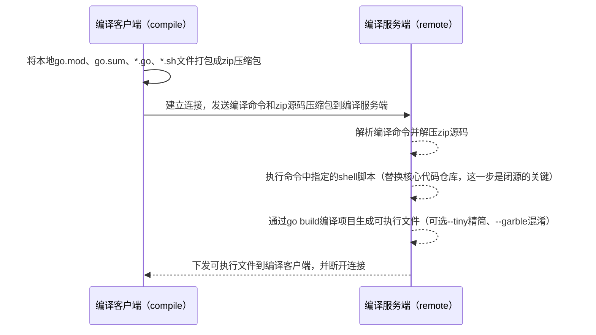

# closed-source-solution

### 1.介绍

closed-source-solution是一款用于Go商业项目闭源化的解决方案。该解决方案分为编译客户端（compile）和编译服务端（remote）两部分组成，主要工作流程如下：



### 2.优势

* 支持商业项目闭源化解决方案。

* 支持自定义shell执行脚本，可根据自身需求做定制化的核心库替换工作。

* 支持 garble 源码混淆（`-literals`、`-tiny`、随机 seed），进一步降低二进制被逆向的风险。

* 支持 `-trimpath`、`-buildvcs=false`、`-ldflags="-s -w -buildid="` 精简参数，去除符号表、build id 与本地路径信息。

* 支持编译客户端侧的自动环境检测（GOOS、GOARCH等），根据环境自动选择合适的编译参数。

* 支持文件分块传输，传输效率非常高。

* 支持服务端编译错误的返回，客户端可根据错误信息进行调试。


### 3.安装

> 使用go install进行安装需要首先安装go 1.27+环境

```bash
go env -w GOSUMDB=off

# 安装编译客户端
go install github.com/dobyte/closed-source-solution/compile@latest

# 安装编译服务端
go install github.com/dobyte/closed-source-solution/remote@latest

go env -w GOSUMDB=on
```

> 安装完成后，将compile和remote分别改为closed-source-solution-compile和closed-source-solution-remote，并添加到环境变量中，即可在任何地方使用。

#### garble 安装（可选）

仅当编译服务端开启 `--garble` 混淆编译时需要，且必须安装在运行 remote 的机器上：

```bash
# 安装最新版
go install mvdan.cc/garble@latest

# 或安装指定版本（推荐，便于与服务端 Go 版本匹配）
go install mvdan.cc/garble@v0.18.0
```

说明：

* 安装目录默认为 `$GOPATH/bin`（Windows 为 `%USERPROFILE%\go\bin`），该目录需在运行 remote 的进程 `PATH` 中，否则会报 `exec: "garble": executable file not found in %PATH%`。
* garble 版本必须支持服务端所用的 Go 版本：实测 go1.27.1 需使用 garble v0.18.0，v0.15.0 会报 `Go version "go1.27.1" is too new; Go linker patches aren't available for go1.26 or later yet`。
* 安装后执行 `garble version` 验证，能输出版本号及构建环境即表示可用。
* 无需额外配置：开启 `--garble` 后，remote 仍会通过环境变量下发 `GOOS`、`GOARCH`、`CGO_ENABLED`，并附加 `-trimpath -buildvcs=false -ldflags="-s -w -buildid="`（`--tiny` 开启时）、`-o` 输出参数。
* 首次使用 garble 编译会重新构建标准库与依赖，耗时明显长于普通 `go build`，后续命中缓存会加快。

### 4.remote用法

```bash
NAME:
   closed-source-solution-remote - remote compile server

USAGE:
   closed-source-solution-remote [global options]

GLOBAL OPTIONS:
   --addr string  specify the address of the server (default: ":8080")
   --tiny         specify whether to strip symbols and paths when compiling; it is disabled by default.
   --garble       specify whether to enable garble obfuscation when compiling; it is disabled by default.
   --help, -h     show help
```

> 开启 `--garble` 混淆编译前，需在编译服务端安装 garble，详见「3.安装」中的 garble 安装说明。

参数说明：

* `--addr`：监听地址，默认 `:8080`。
* `--tiny`：开启后编译会附加 `-trimpath -buildvcs=false -ldflags="-s -w -buildid="`，去除符号表、build id 与本地路径信息，产物更小；默认关闭。
* `--garble`：开启后使用 `garble -literals -tiny -seed=random build` 编译，混淆包名与字符串字面量；默认关闭，需服务端已安装 garble。

服务端限制：

* 单个工程压缩包最大 1GB；解压后总大小不超过 1GB、文件数不超过 10 万个。
* 单连接两次读之间空闲超过 5 分钟会被断开。
* 最大并发连接数 8，超出时新连接会被直接关闭。

### 5.compile用法

```bash
NAME:
   closed-source-solution-compile - local compile client

USAGE:
   closed-source-solution-compile [global options]

GLOBAL OPTIONS:
   --cgo                       specify whether to enable CGO; it is disabled by default.
   --goos string               specify the target operating system; default is current operating system. (default: "windows")
   --goarch string             specify the target architecture; default is current architecture. (default: "amd64")
   --output string, -o string  specify the output file name; default is main.exe on Windows, main on other platforms.
   --packages string           specify the path to the package to compile; default is current directory. (default: ".")
   --shell string              specify the shell to execute before compiling; default is empty.
   --remote string             specify the remote server address
   --help, -h                  show help
```

参数说明：

* `--cgo`：是否开启 CGO，默认关闭。
* `--goos` / `--goarch`：目标操作系统与架构，默认为当前环境。
* `--output`：产物文件名，默认为 `main.exe`（Windows）或 `main`（其他平台）；仅支持文件名，不支持路径。
* `--packages`：待编译的包路径，默认为当前目录；打包时会收集该目录下的 `go.mod`、`go.sum`、`*.go`、`*.sh`。
* `--shell`：编译前在服务端执行的 shell 脚本，用于替换核心库等闭源处理，默认为空。
* `--remote`：编译服务端地址，必填。

> 客户端等待服务端响应的最长空闲时间为 30 分钟，超时会中断并退出。

### 6.使用示例

```bash
# 1. 在编译服务端启动服务（开启精简与 garble 混淆）
closed-source-solution-remote --addr :8080 --tiny --garble

# 2. 在项目根目录执行编译，产物保存到当前目录
closed-source-solution-compile --remote 127.0.0.1:8080 --packages . -o main.exe

# 3. 指定目标平台与编译前脚本
closed-source-solution-compile --remote 127.0.0.1:8080 --packages . \
    --goos linux --goarch amd64 --shell replace.sh -o app
```
